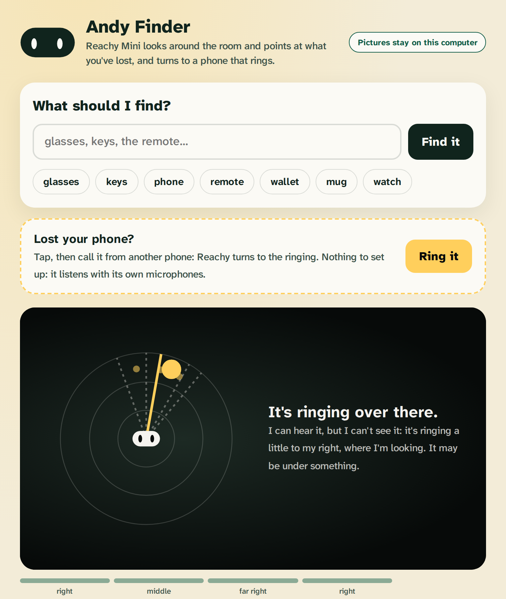
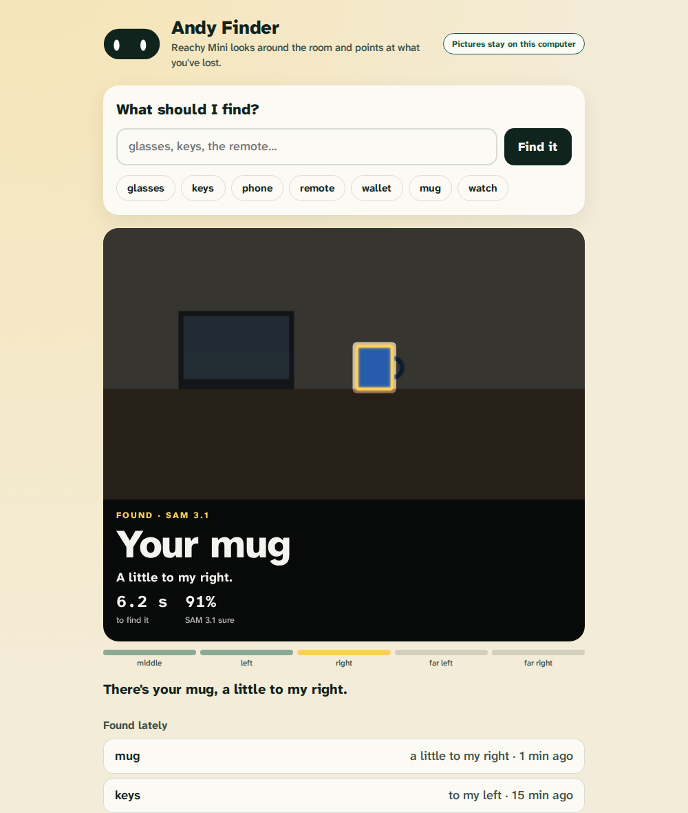

# Andy Finder

**Lost your phone? Tap "Ring it", then call it.** Reachy Mini listens with its own microphones and turns, a step at a
time, until it hears the ringing straight ahead, then nods towards it: "It's ringing a little to my right, where I'm
looking." Nothing to set up: no key, no GPU, no internet; nothing is recorded (only how loud, how pure a tone and
which side, a tenth of a second at a time). With SAM 3.1 it then looks there and shows you the phone. A voice is
never taken for a ringing.

And for anything else: tap what you've lost (glasses, keys, phone, remote, wallet, mug, watch) or type any thing, and Reachy Mini looks around
the room, finds it with Meta's SAM 3.1, turns to it and nods. The app's page shows what it sees as it looks (each view,
every candidate SAM 3.1 outlined, five views lighting up), then the find: a spotlight on the thing, which way it is, how
long it took and how sure SAM 3.1 was. If it can't see it, it shakes its head and says so.

 A small piece of
[HeyAndy](https://github.com/AndyDM9/heyandy-meta), a robot for people who live at home, built for Meta's Global AI
Developer Hackathon.

**Where the camera pictures go, said plainly:**
- **On your computer** (best): if SAM 3.1 runs on this computer at `http://127.0.0.1:8090` (`local/sam_server.py` in
  the HeyAndy repository, with an NVIDIA GPU), every picture stays here.
- **Otherwise, Meta's Model API:** with `MODEL_API_KEY` set, each look sends one camera picture to SAM 3.1 through the
  Model API, and Meta keeps it under its normal terms. Use it in a room you're happy to share. The app's page shows
  which one is in use, and shows a camera picture only while it looks and for two minutes after a find, held in
  memory, never saved.

Install it from the Reachy Mini dashboard (Applications, Discover Apps), or `pip install` this folder and start it.
